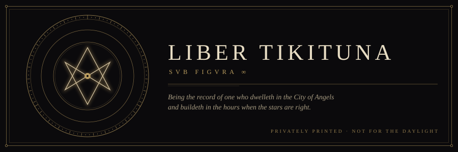

<p align="center">
  
</p>

<p align="center"><em>Do what thou wilt shall be the whole of the Law.</em><br /><sub>Liber AL vel Legis, I. 40</sub></p>

<br />


There is a man in the City of Angels who does not sleep when the city sleeps. The daylight registers have him as Sam Sugarman. The machine on his desk, which keeps its own registers, knows him by another name.

He is a builder of small and particular things. He has been assembled, like most of us, from parts that were not originally his, and he has made his peace with the seams.


*Tikituna.* Say it twice and something surfaces.

The name came up out of the water, as the better names do. The author fly fishes, and keeps faith with certain rivers that have no signal and ask no questions. Those who have read of Innsmouth will understand the risk of taking a name from the sea. He took it anyway. The gills have not come in yet. He checks.


What is built here is built in the small hours: sites and instruments for family and friends, experiments stitched from the parts of older experiments, things that work and things that are merely not dead.

The public shelf is sparse. The private shelf is not. The greater part of the workings is held in a sealed library under conditions the author does not discuss, and the catalogue card below is all that the librarians permit.

```
┌────────────────────────────────────────────────────────────────┐
│  MISKATONIC UNIVERSITY LIBRARY           RESTRICTED COLLECTION │
├────────────────────────────────────────────────────────────────┤
│  CALL NO.    Tik. 93 / Sug.                                    │
│  AUTHOR      Sugarman, Sam. Los Angeles. fl. MMXXVI.           │
│  TITLE       Workings, chiefly nocturnal. 9 vols., 7 sealed.   │
│  SUBJECTS    Side projects — Family archives — Rivers —        │
│              Monsters, cinematic — The parts of other things   │
│  NOTE        Do not read aloud. Do not run in production.      │
│  STATUS      Not dead. Can eternal lie.                        │
└────────────────────────────────────────────────────────────────┘
```


The face on this account is borrowed from Boris Karloff, who borrowed it from Mary Shelley, who borrowed it from a dream she had beside a lake in a year without a summer.

A thing assembled from parts, given current, and immediately misunderstood by the village. The author finds this relatable and declines to elaborate.


<p align="center">
Ship what thou wilt shall be the whole of the Law.<br />
Love is the law, love under version control.<br />
Every rollback is a confession.<br />
Every force-push is a sin, and the author has sinned.<br />
There is no branch but <code>main</code>, and it is not safe either.
</p>


The author may be approached on the following subjects, provided the stars are right:

<p align="center"><em>the monster films of the nineteen-thirties, and why the monster was right &nbsp;·&nbsp; the geometry of a river at dusk &nbsp;·&nbsp; the City of Angels after midnight &nbsp;·&nbsp; the correct way to assemble a thing from parts &nbsp;·&nbsp; what the lights on the hill are for</em></p>

He may not be approached about the basement.


<p align="center"><sub>Set down in the City of Angels in the year MMXXVI, by the light of a single monitor.<br />The stars were approximately right. Nothing was summoned that could not be sent back.</sub></p>
