  

  

  
  
  
  

 

## 🧟 Specimen file

| | |
|---|---|
| **Name** | Sam Sugarman |
| **Habitat** | Los Angeles. The sun is out. I am indoors. |
| **Handle** | `tikituna`, because I fly fish and the fish deserve a namesake |
| **Face** | Boris Karloff as the monster. Stitched together from parts, misunderstood, tremendous forehead. Relatable. |
| **Diet** | Coffee, side projects, movies where the house is the problem |
| **Weakness** | Fire. Also a good river. |

## 🔬 Experiments in progress

- ⚡ Side projects, mostly nocturnal. Some are stitched together from older side projects. That's allowed.
- 🏚️ Small sites and tools for family and friends. They work. Mostly. Don't go in the basement.
- 🎣 Fly fishing. The Creature from the Black Lagoon was just a guy who liked the water.
- 🍿 Rewatching old monster movies and insisting the 1931 one is still the best one.

## 🔦 Rules for surviving the codebase

1. **Cardio.** Scroll past the first error. The real one is further down.
2. **Double tap.** Run the tests twice. The second time with your eyes open.
3. **Never split up.** Pair on the scary parts.
4. **Commit early, commit often.** The thing in the basement is `git stash`.
5. **When it says "It's alive," push.**

## 🪦 The graveyard

> Here lie the side projects. 
> They were loved. Briefly. 
> Some of them will be back. They always come back.

## 🗣️ Ask me about

Old monster movies · fly fishing · Los Angeles after dark · why the monster was the good guy the whole time

## 🐍 Something is eating the commits

  <picture>
    <source media="(prefers-color-scheme: dark)" srcset="https://raw.githubusercontent.com/tikituna/tikituna/output/github-snake-dark.svg" />
    
  </picture>

It is a hungry snake. Most of my commits live in a private lab where it can't reach them.

 

<code>&gt;&lt;(((º&gt;&nbsp;&nbsp;&nbsp;&nbsp;&nbsp;&gt;&lt;(((º&gt;&nbsp;&nbsp;&nbsp;&nbsp;&nbsp;&gt;&lt;(((º&gt;</code>

Made after dark in Los Angeles. It's alive.

